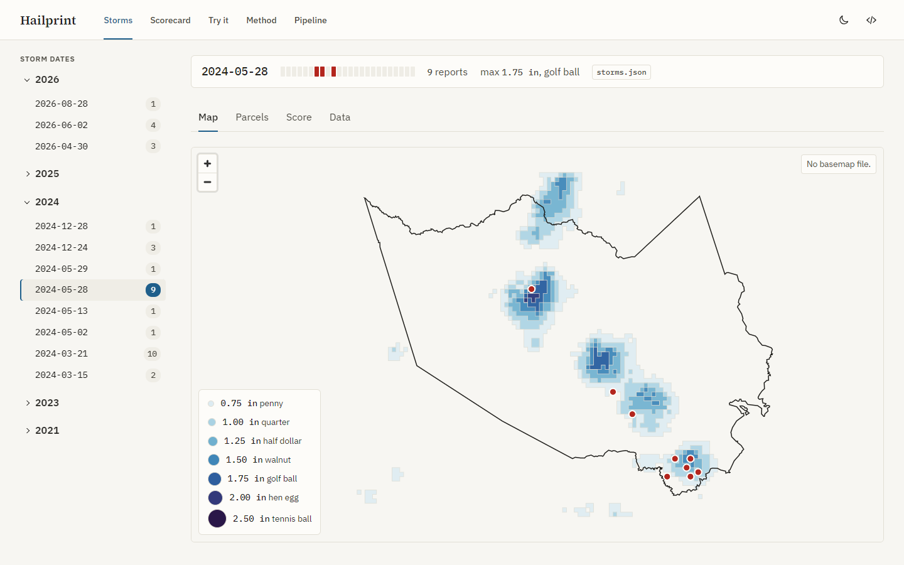

# Hailprint

An open hail-exposure map for Harris County that grades itself against NOAA storm reports.

    

Hailprint draws the MRMS MESH hail swath for each storm date over Harris County, Texas. It counts the HCAD parcels inside each size class and scores the swath against SPC hail reports at every whole-km radius. Every value on the site is a radar-estimated hail size with a confidence band: the published skill ceiling is an HSS of about 0.38 at 30 mm.

Site: https://hailprint.tomnguyen.me

## Features

- **Storms**: one workspace per storm date. The map draws seven nested size classes (0.75 to 2.50 in) and the SPC report points. A map click opens an inspector with the size class at that point and the nearest report.
- **Parcels**: the parcel count per size class and per ZIP code, from HCAD footprints with the owner fields dropped at load.
- **Score**: the contingency table (hits, misses, false alarms, correct negatives) with POD, FAR, CSI, and HSS. A slider re-scores in the browser at any radius from 0 to 20 km.
- **Scorecard**: the pooled table over every published storm date, as a table, a 2 by 2 grid, and a threshold curve with the literature HSS line.
- **Try it**: tune the radius, check one point against every storm date, swipe-compare two storm dates, and copy the commands that rebuild one date.
- **Method**: five short pages on the data, the storm date, the size classes, the scoring, and the limits.
- **Pipeline**: the run log, the archive coverage per year, and the data sources.
- **Receipts**: every number opens a chip with its source, product, file, run time, and confidence band.

## How it works

| Step | Command | Output |
|---|---|---|
| Archive index | `hailprint index` | One row per MESH archive day from one S3 bucket listing |
| Candidate days | `hailprint candidates` | Harris County hail days from the SPC WCM database and daily CSVs, ranked |
| Swath | `hailprint ingest` | The 12Z daily max cropped to the county, dissolved into one polygon per size class |
| Parcels | `hailprint parcels` | Distinct parcel counts per size class and per ZIP |
| Score | `hailprint score` | Per-report distances and the contingency table for each storm date |
| Warnings | `hailprint warnings` | NWS severe thunderstorm, tornado, and flash flood warning polygons for each storm date |
| Publish | `hailprint publish` | Validated JSON under `site/data/`, each file with a receipt |

`scripts/nightly.sh` runs the steps for new storm dates. `scripts/hailprint.cron` starts it at 14:00 UTC, and `scripts/deploy.sh` uploads the site to Vercel.

## Documentation

- [Getting started](docs/getting-started.md): requirements, install, data sources, commands, and checks.
- [Operations](docs/operations.md): the nightly run, the cron entry, the deploy, and the `.env` rules.
- [Site](site/README.md): routes, data path, basemap, and dev harness.
- [Glossary](GLOSSARY.md) and [decisions](docs/DECISIONS.md).
- [Documentation index](docs/README.md): plans, research, and learn-loop entries.

Weekly reports: [01](docs/reports/week-01.md) · [02](docs/reports/week-02.md) · [03](docs/reports/week-03.md) · [04](docs/reports/week-04.md) · [05](docs/reports/week-05.md) · [06](docs/reports/week-06.md) · [07](docs/reports/week-07.md) · [08](docs/reports/week-08.md)

## Ground rules

- Outputs say "radar-estimated hail size" with a confidence band. They make no claim about what the hail did to a property.
- No homeowner names, mailing addresses, or contact data. Owner fields are stripped from HCAD parcels at load.
- Harris County only, HCAD footprints only, in v1.
- No secrets in the repo. The docs name each variable, never its value.
