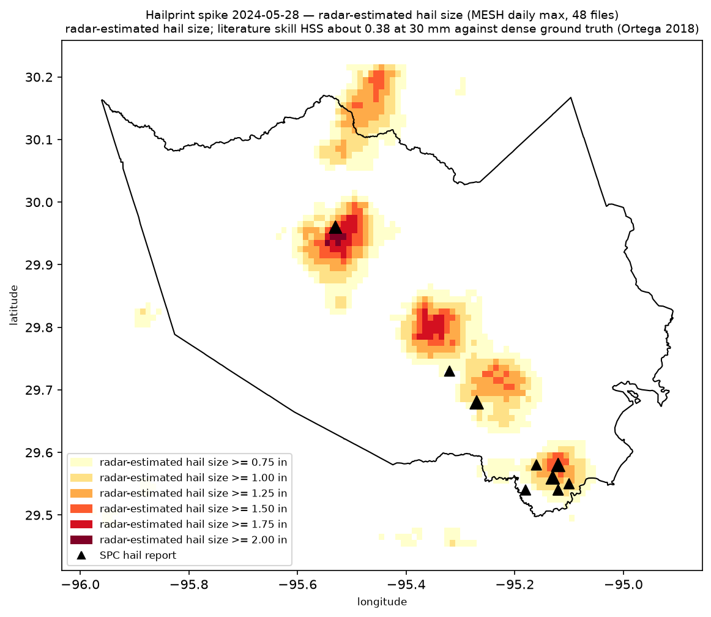

# Week 1 — spike

Goal: one PNG of a MESH hail swath over the Harris County outline for one real storm day.

Oracle: 10 of 10 SPC Harris County reports fall inside the 19.05 mm swath buffered 5 km (target was 7 of 10). Six size classes present; the 63.5 mm class is empty.

## Spike result

| Item | Value |
|---|---|
| Storm date | 2024-05-28 |
| SPC hail reports in Harris County | 10 |
| Max MESH in bbox | 52.8 mm |
| PNG | `out/spike-2024-05-28.png` (copy committed at `docs/evidence/spike-2024-05-28.png`) |
| Swath file | `data/derived/swaths/swaths-2024-05-28.parquet` |
| Test command | `make test` (`uv run pytest -q`) |
| Test result | 23 passed (lint and format clean), 2026-10-24 |

Run it:

```bash
make setup && make spike DATE=2024-05-28
```

Output wording: "radar-estimated hail size" with a confidence band. The band is the `confidence` string in `src/hailprint/swath.py`: literature skill HSS about 0.38 at 30 mm against dense ground truth (Ortega 2018). It appears in the PNG subtitle, the console output, and the GeoParquet metadata. The outputs never claim damage.



## Decisions

- Decode goes through eccodes keys, not `cfgrib.open_dataset`. cfgrib spends 7 s per file on the coordinate build; eccodes reads the grid in 0.4 s, so 48 files decode in 23 s. cfgrib is not a dependency.
- Units: the GRIB2 file carries no unit string (cfgrib reports `unknown`). The NSSL MRMS GRIB2 table gives MESH in mm. The decoded value range (0 to 103.4 in the first file) matches mm, not inches.
- Grid: 3500 x 7000 cells, 0.01 degree, latitude descending, longitude 230.005 to 299.995 (0..360 convention). Sentinels -3 (no coverage) and -1 (no data) become NaN before the max.
- Window: the 48 files stamped on date D are trailing 24-h maxima, so the daily max spans D-1 00:00 to D 23:30 UTC. Week 2 aligns the window to the SPC 12Z-12Z day.

## Admin checklist

- [x] HCAD parcel data downloaded. The public download is a FileGDB (`Parcels.gdb`, layer `Parcels`, 1,546,850 rows, EPSG:2278), not a shapefile. Stored under `data/raw/hcad/` (gitignored).
- [x] Owner fields to strip at load: `CurrOwner`, `mail_addr_1`, `mail_addr_2`, `mail_city`, `mail_state`, `mail_zip`, and the situs fields `LocAddr`, `LocNum`, `LocName`. The loader reads an allow-list only (`HCAD_NUM_1`, `LOWPARCELID`, `zip`, `city`, `yr_impr`, `StatedArea`, `Stacked`, geometry). `tests/test_outputs_clean.py` proves the owner fields are absent from every written file.
- [x] HCAD GIS reuse-terms email drafted: `docs/drafts/hcad-gis-reuse-email.md`. **Tom: confirm the recipient on hcad.org and send.**
- [x] USPTO trademark search (tmsearch.uspto.gov, 2026-10-24): the mark "hailprint" returns no results. No live or dead US mark with that wordmark exists.
- [x] Domain check (RDAP + DNS, 2026-10-24): `hailprint.com`, `.org`, `.io`, `.app`, `.dev` have no registration record. Register before the name is public.
- [ ] **Tom: read the employer IP assignment clause before the first commit of pipeline code reaches the remote.** The kickoff asked for a PR, so the branch is on the private remote; nothing is merged until you confirm.

## Week 2 proposal (approved 2026-10-25, see WEEK-02.md)

1. M1 ingest: `hailprint ingest <date>` writes the daily-max swaths for one date with the window aligned to the SPC 12Z-12Z day.
2. Archive index: list `noaa-mrms-pds` for MESH_Max_1440min from 2020-10-01 to today and store one row per day (date, file count, bytes) as a small Parquet index.
3. Candidate days: join the index with the SPC hail CSV filtered to Harris County, rank the days by report count, and pick the backtest set.
4. Concurrent downloads: replace the sequential loop (the `shortcut:` in `src/hailprint/mesh.py`) once the archive run needs it.
5. Parcel join: intersect the swath classes with the allow-listed HCAD parcels and count parcels per class. No owner data.

## Carried rules

- No homeowner names, mailing addresses, or contact data in any file.
- No secrets in the repo. Name the environment variable, never its value.
- `data/` and `out/` stay out of git.
